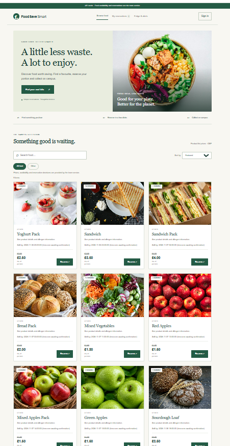
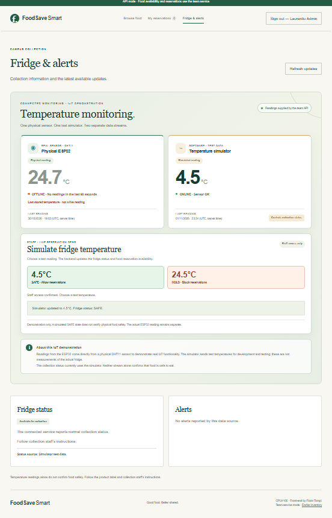
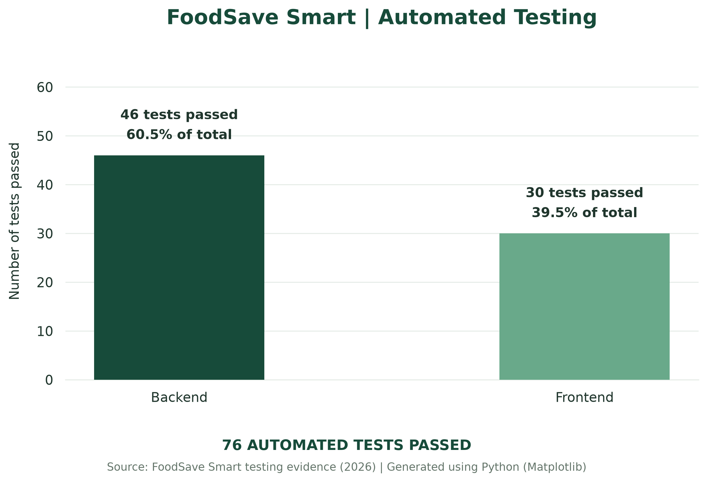

# FoodSave Smart

### Full-Stack Web Application | Food Waste Reduction & Smart Inventory Management

**Academic Software Engineering Project | Team Green | 2026**

FoodSave Smart is a full-stack web application developed to support sustainable food distribution through automated expiry-based discounts, surplus-food reservations, inventory management and temperature-aware safety controls.

The project demonstrates the integration of frontend development, REST APIs, relational databases, authentication, automated testing, IoT monitoring and cloud deployment.

The application supports **UN Sustainable Development Goal 12 – Responsible Consumption and Production**, particularly Target 12.3 on reducing food waste, with a secondary connection to **SDG 2 – Zero Hunger**.

---

## Project Overview

FoodSave Smart addresses two connected challenges:

- Food waste caused by surplus products approaching their expiry dates.
- Affordable access to available food within a university environment.

The system allows users to browse surplus food, view automatically calculated discounts and reserve eligible products.

A temperature-monitoring component provides additional safety controls. When the simulated refrigeration temperature exceeds the configured safe range, the application enters a HOLD state and blocks reservations.

The solution was designed and evaluated as a working academic prototype using demonstration inventory and simulated testing scenarios.

---

## Application Preview

The screenshot below shows the deployed FoodSave Smart interface, including the main landing page, product catalogue, search functionality and available food listings.

*Figure 1. FoodSave Smart web application showing the homepage and surplus-food catalogue.*
 
---

## Live Application

**Frontend:** [Open FoodSave Smart](https://foodsave-smart-1.onrender.com/)

**Backend Health Check:** [View API Status](https://foodsave-smart.onrender.com/api/health)

**Products API:** [View Product Data](https://foodsave-smart.onrender.com/api/products)

### Hosting Availability

The application was deployed using Render for the frontend and backend, with Aiven MySQL providing the cloud database.

The live services were configured for academic demonstration and assessment. Their availability may change after the university project hosting period.

Regardless of hosting availability, the source code and development history remain available in this repository.

Demonstration credentials and privileged access details are not published in this portfolio.

---

## Core Features

### Automated Expiry-Based Discounts

FoodSave Smart dynamically calculates discounts according to the time remaining before a product expires.

| Time Before Expiry | Discount |
|---|---|
| More than 24 hours | 0% |
| 12–24 hours | 25% |
| 6 to under 12 hours | 50% |
| Under 6 hours | 75% |
| Expired | Excluded from available catalogue |

The pricing rules are calculated on the backend.

### Food Reservations

- Authenticated user reservations.
- Product availability and stock validation.
- Transaction-based stock reduction.
- Reservation history.
- Reservation cancellation and stock restoration.
- Prevention of reservations for expired or unavailable products.

### Food Reservation Management

The application allows authenticated users to reserve available food, view their reservation history and cancel pending reservations.

*Figure 4. FoodSave Smart reservation management interface showing a pending Bread Pack reservation and the cancellation option.*

### Authentication and Access Control

- User registration and login.
- Password hashing.
- JWT-based authentication.
- Role-based access for STUDENT, STAFF and ADMIN accounts.
- Protected API endpoints.

### Smart Temperature Monitoring

- Simulated IoT temperature readings.
- ESP32 sensor integration pathway.
- SAFE and HOLD refrigeration states.
- Reservation restrictions during unsafe temperature conditions.
- Authorised temperature simulation.

  
### Temperature Monitoring Dashboard

The dashboard distinguishes between the physical ESP32 sensor and the software-based temperature simulator. The recorded demonstration shows a simulated SAFE temperature of 4.5°C, while the physical sensor is marked OFFLINE and displays its last reported reading.

*Figure 3. FoodSave Smart temperature monitoring dashboard showing simulated SAFE conditions and the physical ESP32 sensor's offline status.*

### Database Integration

A relational MySQL database stores application data including users, food batches, reservations, refrigeration information and temperature readings.

The database was hosted using Aiven MySQL during the project deployment.

---

## Technology Stack

| Area | Technologies |
|---|---|
| Frontend | HTML5, CSS3, JavaScript |
| Backend | Python, Flask |
| Database | MySQL, Aiven |
| Authentication | JWT, password hashing |
| API | REST API, JSON |
| Testing | Pytest, Node.js test runner |
| IoT | ESP32, simulated temperature monitoring |
| Deployment | Render |
| Version Control | Git, GitHub |
| Development | PyCharm |

---

## System Architecture

The application follows a connected frontend, backend and database architecture.

**Frontend**
- Displays food products, prices, reservations and temperature information.
- Communicates with the backend using REST API requests.

**Flask Backend**
- Handles authentication and authorisation.
- Implements discount calculations and reservation logic.
- Validates stock availability and temperature restrictions.
- Communicates with the MySQL database.

**Aiven MySQL**
- Provides persistent application data.
- Stores product batches, user information, reservations and monitoring records.

**Temperature Monitoring**
- Processes simulated temperature readings.
- Supports the ESP32 monitoring pathway.
- Updates refrigeration safety states used by reservation rules.

---

## Automated Testing and Quality Assurance

FoodSave Smart was evaluated using backend and frontend automated test suites.

| Test Suite | Tests Passed |
|---|---:|
| Python Backend and Monitoring | 46/46 |
| JavaScript Frontend and API Contracts | 30/30 |
| **Total** | **76/76** |

### Automated Testing Results

*Figure 2. Automated testing results: 46 backend and 30 frontend tests passed (76 tests in total).*

Testing covered:

- Expiry-based discount calculations.
- Authentication and authorisation.
- Reservation creation and cancellation.
- Stock updates and restoration.
- Product availability rules.
- API contract handling.
- Temperature monitoring and SAFE/HOLD restrictions.
- Error handling and invalid requests.

The recorded test results demonstrate successful execution of the implemented automated test suites. They do not establish production security certification, complete device coverage or measured real-world food-waste reduction.

---

## My Role and Contributions

**Laurentiu-Marius Carlan**

**Scrum Master | Backend Development | Technical Integration | Deployment Coordination**

My contributions to FoodSave Smart included:

- Coordinating development activities, responsibilities and integration across a five-member team.
- Developing and testing Python Flask backend functionality.
- Implementing authentication, reservation processing and automatic expiry-based discount logic.
- Supporting relational database integration with Aiven MySQL.
- Implementing and verifying temperature-aware reservation restrictions.
- Supporting GitHub integration, code reviews and technical documentation.
- Coordinating deployment verification across frontend, backend and database services.
- Running backend tests and reviewing integrated application behaviour.
- Contributing to technical demonstrations, project evaluation and presentation preparation.

My work combined software development, debugging, technical integration, project coordination and quality assurance.

---

## Project Documentation

The project was supported by academic and technical documentation, including:

- System architecture and database documentation.
- REST API contracts and backend implementation.
- Automated test suites and testing evidence.
- Agile Scrum project management records.
- Technical integration and deployment evidence.
- Academic evaluation and presentation materials.

The source files and available technical documentation can be explored through the repository folders:

- `backend/`
- `frontend/`
- `database/`
- `monitoring/`
- `design/`
- `docs/`

---

## Limitations and Future Development

FoodSave Smart was developed as an academic prototype.

Current limitations include the use of demonstration inventory, simulated refrigeration scenarios and limited real-world user evaluation.

Potential future developments include:

- Testing with real food providers and inventory.
- Further validation of physical IoT sensor reliability.
- Formal usability and user acceptance studies.
- Expanded administrative functionality.
- Longer-term cloud deployment.
- Evaluation of real-world food collection and waste reduction outcomes.

---

## Project Background and Attribution

FoodSave Smart was developed collaboratively by **Team Green** as part of the CPU4106 Group Project.

This repository is maintained as part of my personal technical portfolio and highlights my contributions to backend development, technical integration, testing, deployment coordination and Agile Scrum project management.

The original collaborative repository and development history are retained for transparency.

**Original Team Repository:**  
https://github.com/G273105/foodsave-smart

**Personal Portfolio Repository:**  
https://github.com/CLM1398/foodsave-smart

---

## Portfolio Owner

**Laurentiu-Marius Carlan**

Computing Undergraduate | Technology & Digital Innovation

**GitHub Profile:** https://github.com/CLM1398

---

*This repository presents the technical implementation, collaborative development history and evaluation evidence of the FoodSave Smart academic prototype.*
